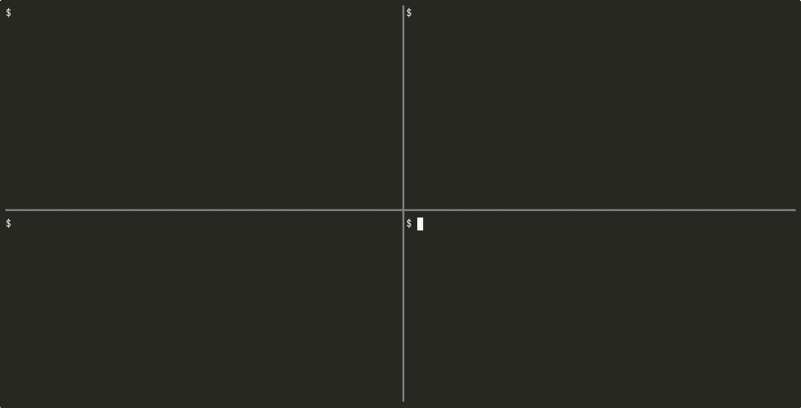

# minibroker

[](https://github.com/BilalWarraich/minibroker/actions/workflows/ci.yml)

A tiny pub/sub message broker over gRPC. Not trying to compete with NATS or Kafka,
I just wanted to understand how fan-out and backpressure work by building one.

Publishers send messages to a topic, subscribers get them through a gRPC server stream.



*Top left: the broker. Right: two subscribers (alice, bob) on `orders`. Bottom left: publishing,
including a burst of 5 concurrent publishes. Then bob disconnects and gets cleaned up, and on
ctrl+c the broker shuts down gracefully and tells the remaining subscriber why.*

```
  pub ──► Publish(topic) ──► broker ──┬──► sub chan (buffered) ──► Subscribe stream ──► client A
                                      ├──► sub chan (buffered) ──► Subscribe stream ──► client B
                                      └──► sub chan (full!)    ──► dropped, kicked after N in a row
```

## How it works

- Each subscriber gets its own buffered channel. Each `Subscribe` RPC runs in its own goroutine
  (grpc gives you that for free) and just reads from the channel and calls `stream.Send`.
- `Publish` never blocks. If a subscriber's buffer is full the message is dropped *for that subscriber*,
  so one slow consumer can't stall everyone else.
- If a subscriber misses `-max-drops` messages in a row it gets disconnected with `RESOURCE_EXHAUSTED`.
- When the client disconnects, the stream ctx is cancelled and the subscription is cleaned up.
- On SIGTERM: health goes to NOT_SERVING, broker closes (which ends all streams), then `GracefulStop`.

### Wildcards

Subjects are dot separated (`orders.eu.created`) and subscriptions can use NATS-style wildcards:

| pattern | matches | doesn't match |
|---|---|---|
| `orders.*` | `orders.created` | `orders.eu.created`, `orders` |
| `orders.>` | `orders.created`, `orders.eu.created` | `orders` |
| `*.created` | `orders.created`, `payments.created` | `orders.eu.created` |

`*` is exactly one token, `>` is one or more and only allowed at the end. You can't publish
to a wildcard subject. Every publish checks all wildcard patterns, which is fine for a few
of them but wouldn't scale to thousands (a trie would).

```
mbctl sub 'orders.>'
mbctl pub orders.eu.created hello
```

Also has:
- logging + bearer token auth interceptors (unary and stream)
- grpc health service and reflection, so `grpcurl` works
- tests using `bufconn` (no real network needed)

No persistence, no acks, at-most-once delivery. Messages published to a topic with no subscribers are just gone.

## Performance

Each topic has its own lock, the broker-wide lock is only held for reading during `Publish`
(to look the topic up). Before that it was one global mutex for everything, so publishers on
completely different topics were waiting on each other.

`go test -bench . ./internal/broker/`, 4 cores, 2 drained subscribers per topic:

| benchmark | global lock | per-topic lock |
|---|---|---|
| 16 topics, parallel publishers | ~515 ns/op | ~194 ns/op (~2.7x) |
| 1 topic, parallel publishers | ~495 ns/op | ~470 ns/op (same) |

The single-topic case doesn't improve, which makes sense, everyone still fights over the
same topic lock. Fixing that would mean something like copy-on-write subscriber lists.

## Running

```
go run ./cmd/minibroker
```

In another terminal:

```
go run ./cmd/mbctl sub chat
```

And another one:

```
go run ./cmd/mbctl pub chat hello there
go run ./cmd/mbctl topics
```

With auth:

```
MINIBROKER_TOKEN=secret go run ./cmd/minibroker
MINIBROKER_TOKEN=secret go run ./cmd/mbctl topics
```

grpcurl:

```
grpcurl -plaintext -d '{"topic":"chat","data":"aGk="}' localhost:50051 minibroker.v1.Broker/Publish
grpcurl -plaintext localhost:50051 grpc.health.v1.Health/Check
```

Flags: `-addr` (`:50051`), `-buffer` per-subscriber buffer (64), `-max-drops` (100).

## Deploying

Not hosted anywhere right now. grpc needs HTTP/2 all the way through, which most free tiers
don't do. Google Cloud Run supports it (set `MINIBROKER_TOKEN`, it reads `PORT` already),
then connect with `mbctl -tls -addr <service>.run.app:443 ...`.

## Regenerating the proto code

Generated code is committed so you don't need protoc just to build. If you change `proto/broker.proto`:

```
go install google.golang.org/protobuf/cmd/protoc-gen-go@latest
go install google.golang.org/grpc/cmd/protoc-gen-go-grpc@latest
make proto
```

## Tests

```
make test
```

## Maybe later

- replay last N messages for new subscribers
- metrics (msgs/sec, drops per topic)
